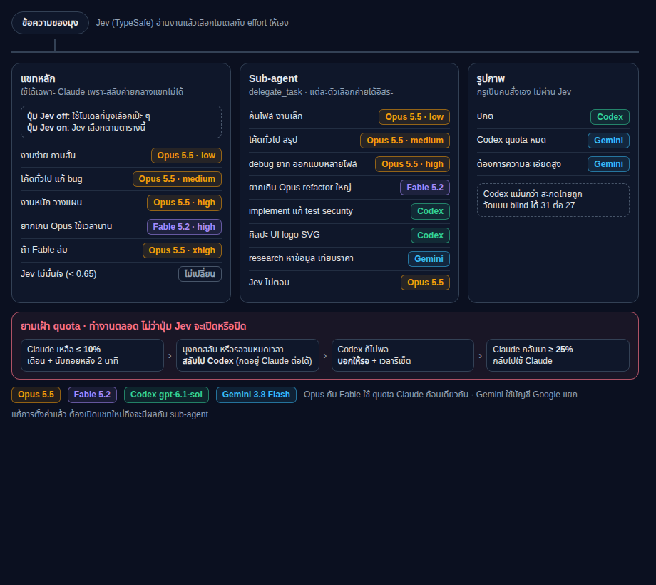

# hermes-jev-quota-routing

Lets TypeSafe Jev pick the model and effort for Hermes Agent, in the main chat and in subagents, under one rule set, with a quota guard that warns first and then moves from Claude to Codex.



## Routes

| Work | Main chat | Subagent |
|---|---|---|
| Quick question, lookup | Opus 5.5 low | Opus 5.5 low |
| Normal coding | Opus 5.5 medium | Opus 5.5 medium |
| Hard debugging, planning | Opus 5.5 high | Opus 5.5 high |
| Beyond Opus 5.5 (long refactor, hard proof) | Fable 5.2 high | Fable 5.2 high |
| Implement, fix a test, security fix | stays on Claude | Codex gpt-6.1-sol |
| Art and visual work (UI, logo, SVG) | stays on Claude | Codex gpt-6.1-sol |
| Research, fact-finding | stays on Claude | Gemini 3.8 Flash (agy) |

- The main chat cannot change provider in the middle of a session, so it stays on Claude. Subagents each choose their own provider.
- Jev unsure (confidence under 0.65): the model you picked is kept.
- The Desktop gets a **Jev on / Jev off** button next to Send. Off = your picked model is used exactly as-is.

## Quota guard (always on, button on or off)

1. Claude at 10% or less: warning plus a 2-minute countdown in the Desktop.
2. You press switch, or the countdown runs out: the session moves to Codex. "Stay on Claude" keeps it.
3. Codex too low as well: Hermes tells you to wait, with the earliest reset time.
4. Claude back at 25% or more: back to Claude.

Without the Desktop app (CLI, messaging), the **cross-provider guard** warns and asks you to wait; it never changes provider on its own. Same-provider account rotation below is independent and does not need the Desktop app.

## Automatic account rotation (Linux)

The installer now configures the existing [account-pool](https://github.com/roqianjas/hermes-account-pool) plugin and its systemd user timer:

- Check live usage **every minute** with `hermes account all balance --threshold 95`.
- At **95% used (5% remaining)**, bench a nearly exhausted account when another account has room. Return it to rotation after its blocking window resets.
- Use `fill_first` for Claude and Codex, so the pool's ordering is respected.
- Reuse `hermes-account-balance.service` / `.timer`; back up existing unit files under `$HERMES_HOME/backups/account-rotation-*` before replacing them. Reinstalling does not create a second timer.
- Start a balance run immediately and verify that the timer is active. If a vendor error makes that first run fail, print a warning and keep the timer retrying; do not hide the remaining installation instructions.
- Pin account rotation to `--profile default`, even when a different sticky profile is selected. The routing installer separately targets the profile identified by `HERMES_HOME`.

The unit files are intentionally normalized to the policy above; custom schedule or command-line options are replaced, with the originals backed up. Unchanged units do not create redundant backups.

This rotates **accounts within a provider**, not Claude to Codex. Claude-to-Codex warnings remain a separate feature. The timer covers providers with accounts; providers without a usage adapter keep their existing order.

Requires multiple signed-in accounts for uninterrupted work. A minute of polling plus vendor usage-reporting delay is not an instant threshold trigger; a large request or parallel burst can still consume the remaining quota. If all accounts are nearly full, account-pool does not bench every account; the quota guard or vendor error handles that case. An explicit environment token may override pool selection; the installer never removes credentials.

Automatic timer setup is **Linux/systemd-user only**. Other platforms or unavailable user managers print a clear "not configured" warning; this is not a Windows/macOS rotation installer. Named profiles skip shared-timer setup; run it from the default profile. An existing timer owned by another Hermes home is left unchanged with an error.

To configure only account rotation on an existing installation:

```bash
python3 scripts/install_account_rotation.py
systemctl --user list-timers hermes-account-balance.timer
hermes account anthropic doctor
```

## Install

Needs: Hermes Agent, a Claude subscription logged in to Hermes, and a TypeSafe API key.

```bash
git clone https://github.com/Antony-12s/hermes-jev-quota-routing
cd hermes-jev-quota-routing
./install.sh
```

The installer:

- copies both plugins into `~/.hermes/plugins` (`HERMES_HOME` respected; old copies go to `~/.hermes/backups/`)
- writes `~/.hermes/jev-routing/main.json`, or keeps yours and saves the new one as `main.json.example`
- enables both plugins and sets `delegation.backend: jev_routes`
- adds the Codex routes only if you have an `openai-codex` login, and the Gemini route only if the `antigravity-oauth` plugin is enabled
- on Linux with a running user systemd manager, installs/enables the catalog `account-pool` dependency and configures the one-minute, 95%-used account-balance timer; existing account-pool installations are enabled, not updated

Then:

1. Add `TYPESAFE_API_KEY=...` to `~/.hermes/.env`.
2. Optional, for the quota guard: `hermes plugins install rarf/hermes-quota-plugin --enable`. Without it the guard has no data and never blocks.
3. Restart the Desktop app, open Settings > Plugins and turn on **hermes-jev-routing**. Desktop plugins from outside the catalog start switched off.
4. Open a **new chat**. A running chat keeps the subagent routing it started with.

## What is in here

| Path | What |
|---|---|
| `plugins/hermes-jev-routing/` | Main-chat routing, Desktop button, quota switch. Fork of Apostol Apostolov's plugin (MIT, see its `LICENSE`). |
| `plugins/typesafe-jev-delegation/` | Subagent backend `jev_routes` and the shared quota rule `quota_gate.py`. Design notes in `DECISIONS.md`. |
| `examples/main.json` | Main-chat routes. |
| `scripts/delegation_options.py` | Builds the subagent routes for the installer. |
| `scripts/install_account_rotation.py` | Sets up account-pool and its Linux user timer (5% left, every minute). |
| `docs/routing-map.html` | The diagram above. |

### Changes to the upstream hermes-jev-routing

- `quota_switch.py`: quota fallback for the main chat (warn, countdown, Codex, wait).
- `jev_toggle.py` and `desktop/plugin.js`: per-session Jev on/off button; quota countdown row.
- `pre_tool_call` hook: asks the model to wrap up when quota hits the floor mid-turn. This is a request to the model, not a guaranteed hard stop.

## Tests

```bash
cd plugins/hermes-jev-routing && python3 -m unittest discover -s tests -q && node --test tests/*.test.mjs
cd ../typesafe-jev-delegation && python3 -m unittest discover -s tests -q
cd ../../scripts && python3 -m unittest discover -s . -q
```

Run them with the Python from your Hermes install if imports fail.

## Privacy

Jev receives the current message, a short excerpt, a context-size estimate and a spend snapshot (see `plugins/hermes-jev-routing/README.md`). Goals that look like they contain a secret are not sent for subagent routing.

## License

MIT. `plugins/hermes-jev-routing` keeps its own MIT notice from Apostol Apostolov.
